<picture>
  <source media="(max-width: 600px)" srcset="./assets/learning-loop-mobile.svg">
  
</picture>

I'm **Preet**. I'm getting deeper into **artificial intelligence** and making it the main direction of my upcoming work here. This is my personal lab: a place for learning, experiments, and future AI projects.

<picture>
  <source media="(max-width: 600px)" srcset="./assets/lab-board-mobile.svg">
  
</picture>

<picture>
  <source media="(max-width: 600px)" srcset="./assets/foundation-mobile.svg">
  
</picture>

<a href="https://github.com/preetsaini2004/traceleakcheck">
<picture>
  <source media="(max-width: 600px)" srcset="./assets/terminal-mobile.svg">
  
</picture>
</a>

<a href="https://github.com/preetsaini2004/traceleakcheck">
<picture>
  <source media="(max-width: 600px)" srcset="./assets/shipped-mobile.svg">
  
</picture>
</a>

[TraceLeakCheck](https://github.com/preetsaini2004/traceleakcheck) · [PyPI](https://pypi.org/project/traceleakcheck/) · [Bug report #5279](https://github.com/open-telemetry/opentelemetry-python-contrib/issues/5279)

<a href="https://github.com/preetsaini2004/sandbox-bench">
<picture>
  <source media="(max-width: 600px)" srcset="./assets/sandbox-bench-mobile.svg">
  
</picture>
</a>

[sandbox-bench](https://github.com/preetsaini2004/sandbox-bench) · [Read the report](https://github.com/preetsaini2004/sandbox-bench/blob/main/REPORT.md)

<a href="https://github.com/preetsaini2004/glowtune">
<picture>
  <source media="(max-width: 600px)" srcset="./assets/glowtune-mobile.svg">
  
</picture>
</a>

[Glowtune](https://github.com/preetsaini2004/glowtune) · [Download for Windows](https://github.com/preetsaini2004/glowtune/releases/latest) · [Watch the launch video](https://github.com/preetsaini2004/glowtune/releases/latest)

<a href="mailto:Preet.saini.0@outlook.com">
<picture>
  <source media="(max-width: 600px)" srcset="./assets/contact-mobile.svg">
  
</picture>
</a>

[Explore my repositories](https://github.com/preetsaini2004?tab=repositories) · [Email me](mailto:Preet.saini.0@outlook.com)

About the lab

**Main focus:** learning and experimenting with artificial intelligence.

**Upcoming work:** turning ideas into AI projects.

**Supporting interests:** ethical hacking, networking, and games.

**Shipped:** [TraceLeakCheck](https://github.com/preetsaini2004/traceleakcheck), an open-source tool that catches secrets leaking through AI apps' monitoring data, [Glowtune](https://github.com/preetsaini2004/glowtune), a desktop music companion with edge glow and synced lyrics, and [sandbox-bench](https://github.com/preetsaini2004/sandbox-bench), an attack benchmark for the sandboxes that contain AI coding agents.

The learning loop: learn, try, build, repeat.

